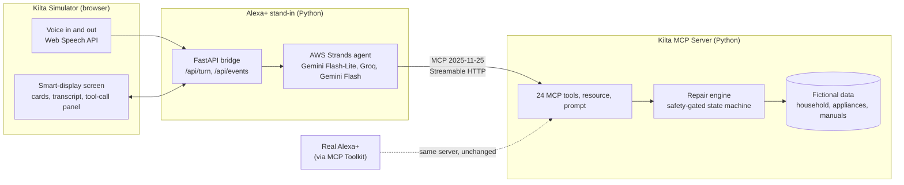
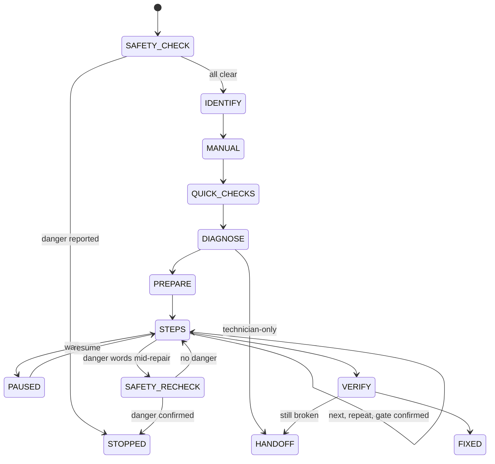

# Kilta

**"Hey Alexa, connect me to Kilta."** A warm, voice-first home appliance repair friend for Alexa+.

[](https://github.com/Swetha-Jalluri/kilta/actions/workflows/ci.yml)


**Demo video:** https://youtu.be/HEEgV5c7LnU

Built for the **Build, Ship, Shape: Amazon Developer Hackathon**, Alexa+ track, with the AWS Builder mini challenge.

---

## The problem

When an appliance breaks, most of us panic. The manual is long gone, we don't know the model number, online advice is generic and sometimes unsafe, and a technician charges $75 to $150 just to diagnose what is often a clogged filter. It's harder still for renters, families more comfortable in another language, and older adults. Existing repair apps live on one person's phone.

## What Kilta does

Kilta lives in the home, inside Alexa+, for everyone in the household.

| | |
|---|---|
| **Safety first** | Checks for gas, burning, sparks, or water near outlets before any repair step |
| **Grounded in your manual** | Every step comes from the appliance's own manual, with the page cited |
| **Simplest fix first** | Settings and quick checks before tools or technicians |
| **Safety gates in code** | Won't continue until you confirm the appliance is unplugged; hides hazardous steps until a safety confirmation |
| **Your language** | Switches language mid-repair per household member, keeping panel labels in English as printed on the appliance |
| **Remembers** | Resumes repairs across sessions and notices repeat problems |
| **Clean handoffs** | Technician summaries and landlord messages in English, with model, error code, and steps already tried |

> A chatbot knows about appliances. Kilta knows yours.

*Kilta is Finnish for "guild": the people who always knew how to fix things.*

---

## Architecture



**Core design decision: rules in code, words from the model.** The repair engine is a deterministic state machine inside the MCP server. It decides what comes next, enforces safety gates, and refuses dangerous jobs. The language model only understands the user and phrases replies warmly. This mirrors how Alexa+ works (Alexa+ handles language and responses; the MCP server owns the logic), keeps safety unbreakable even if the model errs, and means the same server can plug into real Alexa+.

### Repair engine



Safety rules enforced by the engine (and proven by tests):

- No repair step before the safety check passes.
- **"After" gates** (do, then confirm, e.g. unplug) and **"before" gates** (confirm first; the step text stays hidden until confirmed).
- Danger words in the user's own words pause the repair for a safety re-check.
- Gas, refrigerant, internal wiring, and technician-only work are never guided; they route to a handoff.
- Every step carries its manual source (manual id and page).

---

## Tech stack

| Layer | Technology |
|---|---|
| MCP server | Python 3.12, official MCP SDK v1 (`mcp>=1.27,<2`), FastMCP, Streamable HTTP, Pydantic |
| Agent (AWS Builder) | **AWS Strands Agents SDK** with its MCP client and tool-call hooks |
| Models | Gemini Flash-Lite → Groq (gpt-oss-120b) → Gemini Flash, with retry, per-turn budget, and fallback; optional local Ollama |
| Bridge | FastAPI, server-sent events |
| Simulator | React 19, TypeScript, Vite, Tailwind CSS, Motion, Lucide, Web Speech API |
| Agent Skill | `skill/kilta/SKILL.md` in the agentskills.io format |
| Testing | pytest, Playwright, MCP Inspector |
| Tooling | uv, Ruff, GitHub Actions CI |

---

## Quickstart

**Requirements:** macOS or Linux, [uv](https://docs.astral.sh/uv/), Node.js, Google Chrome (for voice).

```bash
git clone https://github.com/Swetha-Jalluri/kilta.git
cd kilta
cp .env.example .env     # add GEMINI_API_KEY (free, Google AI Studio) and optionally GROQ_API_KEY (free, console.groq.com)
make dev                 # MCP server :8765/mcp, bridge :8000, web app :5173
```

Open **http://localhost:5173** in Chrome and click **Start**. Try:

1. "My dishwasher is beeping and there's water at the bottom."
2. "No, nothing like that."
3. "It's shut. The screen says E24."
4. "Okay, ready." then "Next." (Kilta refuses until you confirm it's unplugged)
5. "It's unplugged."
6. Switch the speaker to Lucia: "¿Puedes decirlo en español?"

| Command | What it does |
|---|---|
| `make dev` | Start the MCP server, bridge, and web app |
| `make check` | Ruff, all server and bridge tests, and the web build (no network, no keys) |
| `make test-e2e` | Playwright: scenarios A, B, C typed into the web app with a scripted model and screenshots (run `cd web && npx playwright install chromium` once) |
| `make test-live` | Golden conversations against real models (needs keys; slow and paced) |
| `make reset` | Restore demo data and clear sessions |

Inspect the MCP server directly:

```bash
npx @modelcontextprotocol/inspector --cli http://localhost:8765/mcp --transport http --method tools/list
```

### Bridge API (the Alexa+ stand-in)

| Endpoint | Purpose |
|---|---|
| `POST /api/turn` | `{member_id, text, language}` → `{speech, card, tool_calls, state, session_id, model}` |
| `GET /api/events` | Live tool-call log (server-sent events) |
| `GET /api/health` | MCP server and model chain status |
| `POST /api/reset` | Demo reset (requires header `X-Kilta-Demo: 1`) |

---

## Project structure

```
kilta/
├── server/        Kilta MCP server and repair engine (the product)
├── bridge/        FastAPI + AWS Strands agent, acting as the Alexa+ host
├── web/           Smart-display simulator (React, TypeScript, Vite)
├── skill/kilta/   Agent Skill (SKILL.md)
├── data/          Fictional household, appliances, and manuals ("Kelvara" brand)
└── docs/          Architecture, conversation design, demo script, feedback, friction log
```

---

## Testing

| Suite | Coverage |
|---|---|
| Server (pytest, 117 tests) | Safety-first ordering, gates of both kinds, hidden-step leaks, technician-only handoff, danger and re-check, resume from disk, repeat-problem detection, every tool's response contract, and an integration test asserting the negotiated protocol version is exactly `2025-11-25` |
| Bridge (pytest, 125 tests) | Golden scenarios with a scripted model through the real Strands agent and MCP client, fallback chain, events, reset, speaker switching |
| End to end (Playwright) | Scenarios A, B, C typed into the UI; checks state, cards, tool calls, gate refusal, and that hidden step text never appears on the page |
| Live (opt-in) | Golden scenarios and danger answers in English and Spanish with real models |

CI runs `make check` on every push.

---

## How Kilta meets the hackathon requirements

| Requirement | How |
|---|---|
| Alexa+: self-hosted MCP server, spec 2025-11-25, Streamable HTTP | `server/`, with the protocol version asserted in tests |
| Track technology called at runtime | The Strands agent calls the MCP server live every turn, visible in the behind-the-scenes panel |
| Simulated Alexa+ experience | `web/` + `bridge/` |
| Agent Skill | `skill/kilta/SKILL.md`, validated by a test |
| AWS Builder | AWS Strands Agents SDK powers the agent (no hosted AWS service used) |
| Product feedback and friction log | [`docs/product-feedback.md`](docs/product-feedback.md), [`docs/friction-log.md`](docs/friction-log.md) |

---

## Honest limits

- I did not have Alexa+ Private Preview access, so Kilta runs in a simulated Alexa+ host using the same MCP server.
- All appliances, manuals, and people are fictional (brand "Kelvara"); manuals were written for this project.
- Free-tier model limits shaped the design (fallback chain, state-filtered tools). The last live-model run predates the final small fixes, which are covered by scripted tests.
- Not yet built: MCP Apps visual cards, the explainer animation, real manual search.

## What's next

- Connect to real Alexa+ through the MCP Toolkit
- MCP Apps step cards (`ui://kilta/step-card.html`)
- Real manual search by model number, recall and warranty checks
- More languages and accessibility adjustments
- Opt-in, anonymous repair insights for brands and shoppers
- A hosted demo with per-visitor sessions and rate limits

---

## License

[MIT](LICENSE) © 2026 Swetha Jalluri
