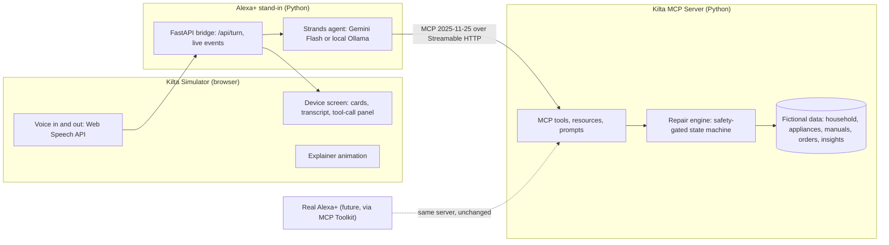
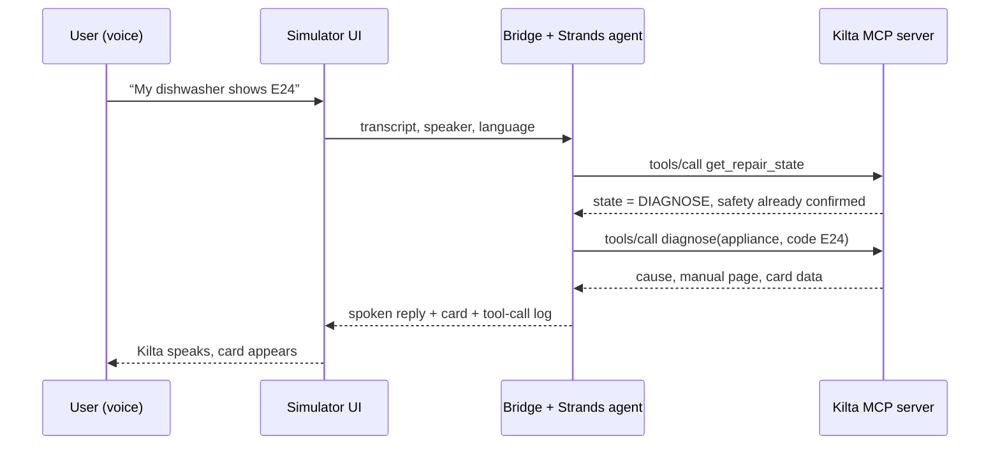
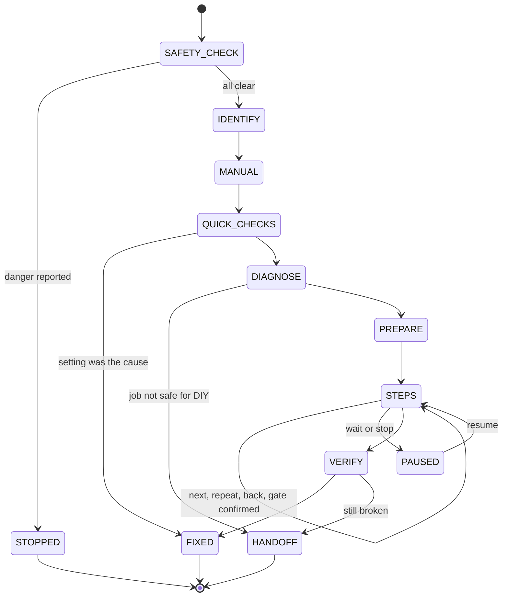

# Kilta: Working Plan and Architecture

**“Hey Alexa, connect me to Kilta.”** A warm, voice-first repair friend that lives in Alexa+.

Version 1.0 · October 21, 2026 · Companion to the Kilta Product Plan
Hard deadline: **Friday, October 23, 2026, 12:00 PM Pacific (3:00 PM Eastern)**
Internal target: **submitted by Friday 10:00 AM Eastern**, leaving five hours of buffer

---

## 1. Research findings that shape this plan

| Finding | What it means for us |
|---|---|
| **Alexa+ already has an MCP Toolkit.** Alexa+ acts as the MCP client and handles language understanding, response generation, and UI rendering. It supports MCP spec 2025-11-25 and the MCP Apps extension. Servers must use Streamable HTTP and be reachable at a remote URL. Onboarding uses the Alexa AI CLI and an Add-on Agent Skill, through a Private Preview that requires approval. | We build a **real, Alexa+-ready MCP server**, so the same server could plug into Alexa+ unchanged. Our web simulator plays Alexa+’s role. We request Private Preview access today but never depend on it. |
| **A newer MCP revision (2026-07-28) exists** and is very different: stateless, no initialize handshake. The hackathon and Alexa+ both name 2025-11-25. | We **pin to 2025-11-25** by using the stable Python SDK v1 line (`mcp>=1.27,<2`), which speaks exactly that revision. |
| **MCP Apps** lets a tool link to a `ui://` HTML resource that the host renders in a sandboxed iframe, talking over `postMessage`. Judges list MCP Apps as a “creative” Alexa+ signal. | The **repair step card ships as an MCP App** (Day 2), so on real Alexa+ it would appear as a visual card. Our simulator renders the same data. |
| **Strands Agents** is AWS’s open-source agent SDK. It is model-agnostic (Gemini, Ollama, and others) with built-in MCP client support. The rules name the Strands SDK as qualifying for the AWS Builder mini challenge. | We use Strands as the agent loop in our simulator, which **enters us in AWS Builder at $0** (no AWS bill). |
| **Agent Skills** is an open standard (a folder with a `SKILL.md`). The Alexa+ track accepts an Agent Skill, and Alexa+ onboarding itself uses one. | We also ship a **Kilta Agent Skill** folder that teaches any agent how to use the Kilta server safely. Small effort, clear bonus. |
| **Amazon Devices Builder Tools** focus on Fire TV and Vega OS. | Not needed for Alexa+. We skip it and don’t claim it in feedback. |
| **Gemini Flash has a free tier** with modest rate limits, and free-tier inputs may be used to improve Google’s products. | Use **only fictional data**. Keep a local fallback model (Ollama) and retries so a rate limit never breaks the demo. |
| **Claude Code best practices:** context is the scarcest resource; give Claude a check it can run; explore, then plan, then code, then commit; keep CLAUDE.md short; use skills, subagents, and `/clear`. | Section 10 turns this into a simple, repeatable loop with copy-paste prompts. |

---

## 2. Non-negotiables from the rules

| Requirement | How Kilta meets it | How we verify |
|---|---|---|
| Alexa+: working MCP server on spec 2025-11-25 over Streamable HTTP (or an Agent Skill, or a simulated Alexa+ experience) | Real MCP server, plus a simulated Alexa+ web app, plus an Agent Skill folder | MCP Inspector, pytest, protocol smoke test |
| Track tech must be imported and actually called at runtime, not just named in the README | The server uses the `mcp` SDK. The simulator’s Strands agent calls the server’s tools live | Tool-call log visible in the app and the video |
| Repo has all source, assets, and clear setup and run instructions | One-command start (`make dev`) and a README quickstart | Fresh-clone test on Friday morning |
| Public repo with an open source license visible in the GitHub About section | Public repo, MIT license | Check the About panel |
| Demo video under 3 minutes, public on YouTube or Vimeo, in English | Scripted, rehearsed, recorded Friday morning | Timer and checklist |
| No third-party trademarks or copyrighted music or footage without permission | Fictional “Kelvara” appliances, a manual we write ourselves, original visuals, no copyrighted music | Visual review before upload |
| Text description of features and functionality | Drafted in `docs/submission.md` during the build | Read-through |
| Product feedback for every tool, API, or SDK used | Maintained in `docs/product-feedback.md` as we go | Covers all five questions per tool |
| AWS Builder: describe AWS services used, in the product feedback | Strands Agents section | Included |
| Identify track and mini challenges | Alexa+ track. AWS Builder. Open Source if time allows | Submission form |
| Project created during the submission window | Brand-new repo | Commit history |
| Authorized use of third-party APIs and data | Gemini terms respected, fictional data only | Review |
| Optional friction log (up to 10% bonus) | `docs/friction-log.md`, logged with a slash command | At least 5 solid entries |

Judges are not required to run the code and may judge from the video and description alone, so those two carry real weight.

---

## 3. End-to-end architecture

### The big picture

### One conversation turn

### The core design decision: rules in code, words from the model

The repair engine is a **deterministic state machine** inside the MCP server. It decides what step comes next, enforces safety gates, and refuses dangerous jobs. The language model only understands what the user said and phrases Kilta’s reply warmly. This mirrors how Alexa+ works (Alexa+ handles language and responses, our server owns the logic), it makes safety unbreakable even if the model makes a mistake, and it makes the demo reproducible.

### Components

| Component | Responsibility |
|---|---|
| **Kilta MCP Server** | Exposes tools, resources, and prompts over Streamable HTTP. Holds the repair engine and data. This is the real product. |
| **Repair engine** | State machine, safety gates, simplest-fix-first ordering, manual grounding, repair history. Fully unit-tested. |
| **Bridge + Strands agent** | Plays the role Alexa+ would: receives a turn, runs the agent with the Kilta system prompt, calls MCP tools, returns speech text, card data, and a tool-call log. |
| **Kilta Simulator (web)** | A smart-display-style device screen with push-to-talk voice, text fallback, member selector, language toggle, cards, a “behind the scenes” tool-call panel, and the explainer animation. |
| **Kilta Agent Skill** | A `SKILL.md` folder teaching any agent how and when to use Kilta’s tools, with the safety rules. |

---

## 4. Tech stack

| Layer | Choice | Why | Cost |
|---|---|---|---|
| MCP server | Python 3.12+, official `mcp` SDK (`>=1.27,<2`) using FastMCP with `streamable-http` | Speaks spec 2025-11-25 exactly; you know Python | Free |
| Packaging | `uv` | Fast, reproducible installs; one command for judges | Free |
| Engine and models | Plain Python with Pydantic | Clear, testable, typed | Free |
| Server tests | pytest | Proves safety gates can’t be skipped | Free |
| Protocol checks | MCP Inspector (`npx @modelcontextprotocol/inspector`) | Same check Amazon recommends before Alexa+ testing | Free |
| Agent loop | Strands Agents SDK with its MCP client | Qualifies for AWS Builder, model-agnostic | Free |
| Language model | Gemini Flash (free tier, Google AI Studio key) | Good tool calling, multilingual | Free tier |
| Fallback model | Ollama with a local tool-calling model | Works offline, no rate limits | Free |
| Bridge API | FastAPI with server-sent events | Simple, streams events to the UI | Free |
| Web app | Vite, React, TypeScript, Tailwind CSS | Fast to build, Claude Code knows it well | Free |
| Animation | Motion (formerly Framer Motion) | Smooth explainer and card transitions | Free |
| Icons | Lucide | Clean, open source | Free |
| Voice | Browser Web Speech API (recognition and speech output) in Chrome | No keys, supports many languages | Free |
| MCP App card | `@modelcontextprotocol/ext-apps` | Real MCP Apps support for Alexa+ visuals | Free |
| UI testing | Playwright, plus Playwright MCP inside Claude Code | Claude can click through the app and screenshot it | Free |
| Code quality | Ruff (Python lint and format), ESLint (web) | Clean, consistent code on GitHub | Free |
| CI | GitHub Actions running tests and the web build on every push | A green badge on the repo, strong signal for judges and recruiters | Free |
| Coding agent | Claude Code | Your main builder | Your plan |
| Repo | GitHub with the `gh` CLI | Claude Code uses `gh` efficiently | Free |
| Optional public URL | Cloudflare quick tunnel | Shows the server is reachable remotely, as Alexa+ requires | Free |
| Video | OBS Studio to record, DaVinci Resolve or Clipchamp to edit, YouTube to host | Professional and free | Free |

---

## 5. MCP surface

### Tools

| Tool | Purpose | Priority |
|---|---|---|
| `get_household` | Members, languages, confidence, renter status, camera preference | MVP |
| `list_appliances` / `get_health_card` | Appliance registry and history | MVP |
| `identify_appliance` | From a spoken model code (letter by letter), guided questions, or order history | MVP |
| `lookup_orders` | Simulated Amazon order history, appliances only, with permission | Simulated |
| `find_manual` / `search_manual` | Confirm the right manual, return sections with page references | MVP |
| `safety_check` | Danger questions and stop instructions | MVP |
| `start_repair` / `get_repair_state` | Create or resume a repair session | MVP |
| `quick_checks` | Settings and simple causes first | MVP |
| `diagnose` | Error code or symptoms to likely cause, manual-grounded | MVP |
| `next_step` / `confirm_gate` / `pause_repair` / `go_back` | Voice-paced steps with enforced safety gates | MVP |
| `report_result` | Fixed or not, updates the health card, detects repeat problems | MVP |
| `create_technician_summary` / `draft_landlord_message` | English handoffs | MVP |
| `check_warranty` | Estimate from purchase date | Simulated |
| `build_parts_cart` | Mock cart, needs explicit confirmation | Simulated |
| `share_insight` / `get_insights` | Opt-in anonymous insights, synthetic aggregate data | Simulated |

### Resources and prompts

| Item | Purpose |
|---|---|
| `ui://kilta/step-card.html` | MCP App rendering the current step card |
| `kilta://manuals/{manual_id}` | Manual text as a readable resource |
| Prompt `start-repair` | A ready-made entry prompt for hosts that support prompts |

### Tool result contract

Every tool returns three things: a short `content` text that works when spoken aloud, `structuredContent` with the card data, and (for step tools) `_meta.ui.resourceUri` pointing to the MCP App. Our simulator renders `structuredContent` natively, while a real Alexa+ host could render the MCP App.

---

## 6. Repair engine

| Rule | Enforced where |
|---|---|
| No repair step before the safety check passes | Engine refuses and returns the safety step |
| A gated step can’t advance until its gate is confirmed | `next_step` refuses until `confirm_gate` |
| Gas, refrigerant, internal wiring, and “technician only” steps are never guided | Refusal list in data, engine routes to handoff |
| Every step names its manual source | Steps without a reference fail validation |
| Sessions persist and resume | Saved to JSON after every change |

---

## 7. Data (all fictional)

| File | Contents |
|---|---|
| `data/household.json` | Two members with different languages and confidence, renter flag, preferences |
| `data/appliances.json` | Kelvara DW-300 dishwasher and Kelvara WM-500 washer, with purchase dates and past repairs |
| `data/manuals/kelvara-dw300.json` | A manual we write: error codes, pages, quick checks, step lists, tools, times, gates, technician-only flags |
| `data/manuals/kelvara-wm500.json` | Same for the washer |
| `data/orders.json` | Simulated order history |
| `data/insights.json` | Synthetic aggregate repair insights |
| `data/sessions/` | Saved repair sessions (created at runtime) |

Writing our own manuals keeps the repo free of copyrighted material and lets us design the perfect demo scenario.

---

## 8. Simulator UI and explainer animation

| Screen | What it shows |
|---|---|
| **Explainer animation** (about 25 seconds, skippable) | A home full of appliances, something breaks, “Hey Alexa, connect me to Kilta,” Kilta guides step by step, fixed or handed off, closing on the guild idea. Doubles as the video opener |
| **Device simulator** | A smart-display frame with a glowing listening ring, waveform, push-to-talk mic, text fallback, transcript strip, and one large card at a time |
| **Member and language controls** | Switch who is speaking and their language, showing personalization live |
| **Behind the scenes panel** | Live list of MCP tool calls and engine state, so judges see the real tech working |
| **Health card and handoff views** | Appliance history, technician summary, landlord message |
| **Insights dashboard (concept)** | Anonymous, aggregated repair trends with the consent screen |

Design direction: warm and calm, large type, light and dark mode, an original Kilta wordmark with a small house-and-wrench emblem. Avoid copying Amazon’s official logos or device artwork; use a generic smart-display frame.

---

## 9. Reliability plan: no glitches on camera

| Risk | Protection |
|---|---|
| Model says something off-script | Engine decides the flow, the model only phrases. Golden conversation tests replay the demo script and check the tool order |
| Free-tier rate limit (HTTP 429) | Retries with backoff, then a fallback chain: Gemini Flash, then Flash-Lite, then local Ollama |
| Microphone mishears | Codes read back for confirmation, letter-by-letter entry, visible transcript, text input always available |
| State drifts between takes | **Demo Mode** with seeded data and a one-click reset |
| Something breaks late | Feature freeze Thursday 10:00 PM. Friday is recording and submission only |
| Bad recording | Record two full takes and keep the better one |

---

## 10. Claude Code playbook (the easy way)

### 10.1 One-time setup (about 20 minutes)

1. Create the repo on GitHub (public, MIT license) and clone it.
2. Copy in the **Kilta Claude Code kit**: `CLAUDE.md`, the `docs/` folder, and the `.claude/` folder (I’ll generate this next).
3. Install the helpers: `uv`, Node LTS, the `gh` CLI (run `gh auth login`), and Chrome.
4. Add Playwright MCP so Claude can test the UI itself: `claude mcp add playwright -- npx @playwright/mcp@latest`.
5. Start Claude Code in the repo with `claude`, then run `/context` to confirm it loaded `CLAUDE.md`.

### 10.2 What’s in the kit

| File | Purpose |
|---|---|
| `CLAUDE.md` | Short project rules: commands, architecture rules, safety rules, “always run tests” |
| `docs/product-plan.md` | The full product plan |
| `docs/architecture.md` | This architecture, tools, engine, data contracts |
| `docs/hackathon-rules.md` | The non-negotiables checklist |
| `docs/conversation-design.md` | Kilta’s voice, tone, and sample dialogues |
| `docs/demo-script.md` | The golden demo scenario (draft) |
| `docs/friction-log.md` and `docs/product-feedback.md` | Filled in as we go |
| `.claude/skills/kilta-voice/` | Loaded only when writing Kilta’s words |
| `.claude/skills/mcp-server-rules/` | Loaded only when touching the MCP server |
| `.claude/agents/reviewer.md` | Fresh-eyes reviewer checking diffs against the plan and safety rules |
| `.claude/commands/friction.md` | `/friction` adds a friction log entry in the right format |
| `.claude/commands/phase.md` | `/phase N` runs the standard loop for a build phase |

### 10.3 The loop for every phase

1. **Fresh start:** run `/clear` (or open a new session) so old context doesn’t pile up.
2. **Plan:** press `Shift+Tab` until plan mode is on, paste the phase prompt, and read the plan. Press `Ctrl+G` to edit it if needed.
3. **Build:** approve the plan and let Claude implement it.
4. **Prove it:** Claude must run the tests or checks and show the output, not just say “done.”
5. **Review:** ask “Use the reviewer subagent to check this diff against docs/architecture.md.”
6. **Commit:** “Commit with a descriptive message.” Then `/friction` for anything that was painful.

### 10.4 Phase prompts (copy and paste)

**Phase 1, MCP server and engine:**
> Read @docs/architecture.md sections 5 to 7 and @CLAUDE.md. Plan and build the Kilta MCP server in `server/` using the `mcp` Python SDK (>=1.27,<2) with streamable-http, the repair engine state machine, and the fictional data files. Write pytest tests proving: no step runs before the safety check, gated steps can’t advance without confirmation, technician-only steps route to handoff, and sessions resume. Run the tests and show me the output. Then start the server and list its tools with MCP Inspector’s CLI mode.

**Phase 2, agent bridge:**
> Read @docs/architecture.md section 3 and @docs/conversation-design.md. Build `bridge/`: a FastAPI app that runs a Strands agent connected to the Kilta MCP server over streamable HTTP, using Gemini Flash with retry and an Ollama fallback. Return speech text, card data, and a tool-call log per turn. Add golden conversation tests that replay @docs/demo-script.md and check the tool order. Run them and show results.

**Phase 3, simulator UI:**
> Read @docs/architecture.md section 8. Build `web/` with Vite, React, TypeScript, Tailwind, and Motion: the device screen, push-to-talk voice with the Web Speech API, text fallback, member and language switch, cards from structuredContent, and the behind-the-scenes tool panel. Use Playwright to run the demo scenario end to end, screenshot each card, and fix anything that looks wrong.

**Phase 4, explainer and extras:**
> Build the 25-second skippable explainer animation, the health card and handoff views, the insights dashboard concept with consent, and Demo Mode with one-click reset. Verify with Playwright screenshots.

**Phase 5, MCP App and Agent Skill:**
> Add `ui://kilta/step-card.html` as an MCP App using @modelcontextprotocol/ext-apps, linked from the step tools via `_meta.ui.resourceUri`. Create `skill/kilta/SKILL.md` following the Agent Skills spec. Verify the server still passes all tests and Inspector checks.

**Phase 6, polish and submission:**
> Do a fresh-clone test: follow README from scratch in a temp folder and fix anything missing. Then draft `docs/submission.md` (description), finalize `docs/product-feedback.md`, and check every item in @docs/hackathon-rules.md, reporting anything not met.

### 10.5 Golden rules

| Do | Don’t |
|---|---|
| One phase per session, `/clear` between phases | Mix unrelated tasks in one long session |
| Ask for evidence: test output, screenshots | Accept “it works” without proof |
| Point to files with `@` | Describe files vaguely |
| Correct early with `Esc`; after two failed fixes, `/clear` and re-prompt better | Keep correcting the same thing in a cluttered session |
| Commit after every working step | Let a day of work sit uncommitted |
| Keep CLAUDE.md short; put details in docs and skills | Paste huge documents into CLAUDE.md |

### 10.6 Handy controls

| Control | What it does |
|---|---|
| `Shift+Tab` | Cycle modes, including plan mode |
| `Esc` | Stop Claude mid-action |
| `Esc` twice or `/rewind` | Go back to an earlier checkpoint |
| `/clear` | Reset context between tasks |
| `/compact` | Summarize a long session |
| `/context` | See what’s using context |
| `/rename` | Name a session, for example `phase-1-server` |
| `claude --continue` | Resume the last session |
| `/btw` | Ask a quick side question without adding to context |

---

## 11. Schedule (Eastern Time)

| When | Block | Done means |
|---|---|---|
| **Wed evening, 1 hour** | Setup: repo, kit, Gemini key, Ollama model download, Claude Code config. Request Alexa+ Private Preview access. Start the friction log | `claude` runs in the repo and loads CLAUDE.md |
| **Wed night, 3 hours** | Phase 1: MCP server, engine, data, tests | All tests pass, Inspector lists the tools |
| **Thu 8 AM to 12 PM** | Phase 2: agent bridge and golden tests | Demo script passes end to end through the API |
| **Thu 1 PM to 5 PM** | Phase 3: simulator UI with voice | Full demo works by voice in Chrome |
| **Thu 5 PM to 8 PM** | Phase 4: explainer, health card, handoffs, insights, Demo Mode | Playwright screenshots look right |
| **Thu 8 PM to 10 PM** | Phase 5: MCP App and Agent Skill. **Feature freeze at 10 PM** | Tests still green |
| **Thu 10 PM to 11 PM** | Two full rehearsals, fix only real bugs | Two clean runs in a row |
| **Fri 7 AM to 9 AM** | Phase 6: fresh-clone test, record two takes, edit to under 3 minutes | Video uploaded, public |
| **Fri 9 AM to 10 AM** | Submit: description, repo link, video, feedback, friction log, tracks | Submission confirmed on Devpost |
| **Fri 10 AM to 3 PM** | Buffer only | |

Sleep is part of the plan. Tired debugging at 3 AM costs more time than it saves.

---

## 12. Risks

| Risk | Mitigation |
|---|---|
| Not enough time for everything | Simulated column stays simulated. MCP App and Agent Skill are Day 2 stretch |
| Free model problems | Fallback chain and Demo Mode |
| SDK version confusion between MCP revisions | Pin `mcp>=1.27,<2` and test early |
| Alexa+ Private Preview not approved in time | Expected. Simulator covers the demo; log it as a friction entry |
| Voice recognition varies by browser | Record in Chrome; text fallback always present |
| Judges compare with other repair apps | The video names Kilta’s differences directly |

---

## 13. Decisions needed before we start

| Decision | Options |
|---|---|
| Name spelling | **Kilta** (as researched) or “Kilty” |
| Language model | Gemini Flash free tier, local Ollama, or both (recommended) |
| Laptop | Mac, Windows, or Linux, and roughly how much memory (affects Ollama) |
| Open Source mini challenge | Yes (publish the simulator as a separate reusable repo) or skip |
| Team | Solo or with teammates |

---

## 14. References

Alexa+ MCP Toolkit overview and quickstart, and Alexa+ add-on development stages (developer.amazon.com/docs/alexaplus) · MCP specification changelog for the revision after 2025-11-25 (modelcontextprotocol.io) · MCP SDK beta announcement (blog.modelcontextprotocol.io) · MCP Apps extension (github.com/modelcontextprotocol/ext-apps) · Strands Agents (pypi.org/project/strands-agents) · Agent Skills (agentskills.io) · Amazon Devices Builder Tools (developer.amazon.com/docs/adbt) · Claude Code best practices (code.claude.com/docs/en/best-practices) · Gemini API free tier guides (2026)
