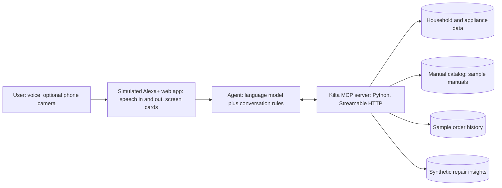

# Kilta: Product Plan

**A warm, voice-first repair partner that knows your home**

Name: Kilta (Finnish for “guild”; it puts your home back in kilter) · Version 1.1 · October 21, 2026
Built for the Build, Ship, Shape: Amazon Developer Hackathon, Alexa+ track

---

## 1. Summary

**One line:** Kilta walks every member of a household through fixing their home appliances by voice, safely and patiently, in their own language, using their exact model’s manual, and hands off cleanly to a technician or landlord when a fix isn’t safe to do at home.

**The pitch:** When an appliance breaks, people are stressed, their hands are busy, the manual is long gone, and they don’t know the model number. Today’s options are a phone app they have to hold with wet hands, a generic chatbot that forgets them after one answer, or a technician who charges just to show up. Kilta lives on the home assistant. It knows every appliance in the house, finds the model and the manual for you, checks for danger first, tries the simplest fix before the expensive one, and talks you through each step at your pace. If the job isn’t safe, it prepares everything the technician or landlord needs, in English, even if the family spoke to it in Hindi or Spanish.

**What makes it different:** A chatbot knows about appliances. Kilta knows *your* appliances, *your* household, and what has actually worked.

---

## 2. Hackathon context

| Item | Decision |
|---|---|
| Primary track | Alexa+ |
| Build path | A real MCP server (spec 2025-11-25 or later, Streamable HTTP) plus a simulated Alexa+ web app that shows the experience |
| Mini challenges | AWS Builder skipped (no budget). Open Source optional if time allows |
| Budget | $0. Free tools only (see Section 12) |
| Hardware needed | None |
| Deadline | Friday, October 23, 2026, 12:00 PM Pacific (3:00 PM Eastern). Aim to submit by 9:00 AM Eastern for buffer |
| Required submission | Text description, GitHub repo, demo video under 3 minutes, product feedback, track selection |
| Bonus | Friction log entries can earn up to a 10% judging bonus. We keep one as we build |
| Judging | Tech implementation, design, potential impact, quality of idea, all weighted equally |

---

## 3. The problem

Every household owns appliances, and every appliance eventually beeps, leaks, or stops. The moment it happens is stressful: dishes are dirty, clothes are wet, and someone has to figure out what to do.

The person standing in front of the appliance usually faces several problems at once. They don’t know the model number or where to find it. The manual was thrown away years ago. The error code means nothing to them. Their hands are wet or dirty, so holding a phone and scrolling through a video is awkward. Advice online is generic and sometimes unsafe. And if they call a technician, they pay a service call fee (typically $75 to $150) just for someone to diagnose a problem that is often a clogged filter or a setting.

Some households face extra barriers. Families who are more comfortable in a language other than English struggle with English manuals, technicians, and landlords. Renters often don’t know whether a repair is their responsibility. Older adults may not be able to kneel or read small print. First-time homeowners and students often have no one handy to call.

---

## 4. Who it’s for

| Persona | Situation | Pain today | What Kilta does |
|---|---|---|---|
| **Priya, grad student renter** | Shares an apartment, dishwasher won’t drain | Doesn’t know if she should fix it or call the landlord, can’t afford a service call | Checks simple fixes first, recognizes she’s renting, drafts a clear landlord message if needed |
| **The Morales family** | Grandmother runs the washer, prefers Spanish | English manual and English-speaking technicians | Guides her in Spanish, keeps panel labels in English, writes the technician summary in English |
| **Harold, 74, lives alone** | Washer showing an error | Can’t easily kneel, small print is hard to read | Goes slowly, large text cards, warns before physical steps, suggests getting help for the hard part |
| **Sam and Jordan, first-time homeowners** | Fridge making a new noise | No handy family member, no idea what’s normal | Diagnoses by sound with simple questions, explains what’s normal, keeps a health card for the fridge |
| **Aisha, busy parent** | Needs the washer working tonight | No time for long videos or waiting for a technician | Fast, hands-free, simplest fix first, resumes after interruptions from the kids |

---

## 5. Competitive landscape

### What exists today

| Product | What it offers | Where it falls short |
|---|---|---|
| **iFixit FixBot** (closest competitor) | Photo diagnosis, step-by-step guidance, manual uploads, hands-free voice mode, grounded in iFixit’s guide library | Free voice mode capped at about 15 minutes a day in early testing, voice and uploads moving behind paid tiers, reviewers reported generic or unsafe suggestions and jumping to “call a technician” without basic checks, coverage gaps for older or niche models, phone-based |
| **Phone repair apps** (Fix My Beep, AIppliance Manager, Fix Stuff AI, Reparo, RepairBuddy) | Error code lookup from photos, chat with manuals, step-by-step guides, some organize appliances by room | Phone-based and photo-first, voice is rare or paid, no household memory, no handoff to technicians |
| **Manufacturer apps** (for example LG ThinQ Smart Diagnosis) | Diagnosis for that brand’s connected appliances, service booking, AI chat | One brand only, requires a compatible connected appliance and setup |
| **Alexa brand skills** | Control connected appliances (“is the dishwasher done?”) | Control, not repair. Only for connected appliances of that brand |
| **Student projects** (for example V-Fix at METU) | AI diagnosis with follow-up questions and technician booking | Shows the space is active, still a phone or web chat experience |
| **FixMode** (“Rex”) | Live-camera AI repair guidance with hands-free, real-time voice | Phone-based, one user, credit-based pricing, no household memory or handoffs |
| **Toolbox** | Video diagnosis with Green, Amber, Red safety routing, matches you with local pros | Phone-based, video-first, not voice-guided step by step |
| **Picmend** | Photo diagnosis for renters and young homeowners, finds local pros | Photo-first phone app, no voice guidance or landlord handoff |
| **Fixle** | Scan an appliance data plate to get manuals, recalls, energy guides | Information and inventory, not guided repair |
| **Fix app (Fix.com)** | Home appliance inventory that adds manuals, guides, and parts by model number | Inventory and parts, not voice-guided repair |

### Gaps nobody fills together

No existing product combines all of these: a household-level, voice-first experience on the home assistant; answers grounded in the exact model’s manual with the source shown; hard safety gates; simplest-fix-first diagnosis; resuming across sessions; repair-aware translation; renter awareness; and a clean handoff to a technician or landlord.

### How we compare

| A general assistant or repair app | Kilta |
|---|---|
| Answers once, then forgets | Remembers every appliance, past repair, and the fix that worked |
| Generic advice from the internet | Your model’s manual, with the page or section named |
| Free-form chat that can wander | A structured flow: safety, simplest fix first, one step at a time |
| Can suggest unsafe steps | Hard safety gates it will not skip |
| Same answer for everyone | Adapts to each person’s language, skill, body, tools, budget, and renter status |
| Translates words | Translates the manual while keeping panel labels in English, and writes handoffs in English |
| Stops at advice | Finds the manual, checks warranty, prepares parts orders and handoff messages |
| Learns nothing from others | With opt-in, learns which fixes actually worked for the same model in other homes |

---

## 6. Product principles

| Principle | What it means in practice |
|---|---|
| **Voice first** | Everything works without touching a screen. Screen cards and the camera only add convenience |
| **Safety first** | Danger checks come before anything else. Certain steps can’t be passed without confirmation. Dangerous jobs are refused kindly and routed to a professional |
| **Simplest fix first** | Settings and free checks always come before parts, tools, or technicians |
| **Grounded and honest** | Steps come from the model’s manual and the source is named. When no manual is found, general advice is clearly labeled |
| **Warm and patient** | Acknowledge the stress, never blame, one step at a time, celebrate progress |
| **Personal** | Adapts to each household member, not just each household |
| **Private by design** | Only what’s needed is stored, users can see and delete it, and sharing is always opt-in |

---

## 7. End-to-end experience

| Stage | What the user does or says | What Kilta does | Screen card |
|---|---|---|---|
| **1. First-time setup** | Adds household members and appliances, or skips | Asks language, confidence level, renter or owner, camera preference, tools on hand. Can add appliances from Amazon order history with permission | Household profile |
| **2. Something’s wrong** | “My dishwasher’s beeping and there’s water inside” | Acknowledges the stress, then runs the safety check | Safety check |
| **3. Identify the appliance** | Says the model code, or doesn’t know it | Recognizes a registered appliance, or guides them to the sticker, asks simple questions, offers order history lookup or an optional photo | Appliance identified |
| **4. Find the manual** | Confirms the match | Finds the model’s manual and confirms it’s the right one, or says honestly that none was found | Manual found |
| **5. Quick checks** | Answers yes or no | Checks settings and simple causes: door latch, child lock, delay start, power | Quick checks |
| **6. Diagnose** | Reads the error code or describes symptoms | Looks up the code in the manual, asks targeted questions about lights, beeps, and sounds | Likely cause, with manual page |
| **7. Prepare** | Gathers tools | Says how long it takes, what tools are needed, checks warranty and recalls | Before you start |
| **8. Guided fix** | “Next,” “repeat,” “wait,” “go back” | One step at a time, safety gates on risky steps, pauses for interruptions, remembers progress | Step N of M |
| **9. Check the result** | Runs a test cycle | Confirms whether it worked | Did it work? |
| **10a. Fixed** | Celebrates | Updates the appliance health card, offers optional anonymous sharing of what worked | Fixed, health card updated |
| **10b. Not fixed or not safe** | Chooses next step | Prepares a technician summary or a landlord message in English, or a parts order for confirmation | Handoff ready |
| **11. Later** | Comes back another day | Resumes an unfinished repair, or notices repeat problems on the health card | Welcome back |

---

## 8. Feature specification

Priority key: **MVP** means built for real. **Simulated** means built with sample data for the demo. **Roadmap** means described in the write-up only.

### 8.1 Household profile and personalization

| Feature | Description | Priority |
|---|---|---|
| Household members | Each person has a preferred language, confidence level, and pace (“quick version” or “go slowly”) | MVP |
| Speaker adaptation | Adapts to whoever is speaking. In the demo, a member is chosen on screen. In production, Alexa voice profiles would identify them | MVP (manual select) |
| Renter or owner | Changes advice and offers a landlord message for renters | MVP |
| Camera preference | Voice only, or offer a photo when stuck | MVP |
| Accessibility needs | Avoids or warns before kneeling, lifting, or fine motor steps, suggests getting help | Roadmap |
| Tools on hand | Remembers tools and warns about missing ones before starting | Roadmap |
| Budget style | Cheapest fix or fastest fix preference | Roadmap |
| Memory controls | View and delete anything remembered | MVP (simple view) |

### 8.2 Appliance registry, model identification, and manual finder

| Feature | Description | Priority |
|---|---|---|
| Appliance registry | Every appliance with type, model, location, and purchase date | MVP |
| Find the model by voice | Explains where the model sticker usually is for each appliance type, takes the code letter by letter, reads it back to confirm | MVP |
| Identify by questions | Narrows down the model from brand and simple features when the sticker can’t be found | MVP (small catalog) |
| Amazon order history | With permission, finds appliances the household bought on Amazon | Simulated |
| Photo of the sticker | Optional camera to read the model sticker | MVP if time allows |
| Manual finder | Searches the manufacturer’s site first, then manual libraries, and confirms the match | Simulated (local catalog of sample manuals) |
| Honest fallback | If no manual is found, gives general advice clearly labeled as such, with extra caution | MVP |

### 8.3 Safety

| Feature | Description | Priority |
|---|---|---|
| Safety triage | Asks about gas smell, burning smell, smoke, sparks, and water near outlets before anything else. Stops and gives safety steps if yes | MVP |
| Safety gates | Certain steps require spoken confirmation (for example “it’s unplugged”) before continuing | MVP |
| Refusal list | Gas lines, refrigerant, internal electrical wiring, and anything the manual marks for a qualified technician are never guided. Routed to a professional kindly | MVP |
| Recall check | Checks whether the model has a safety recall | Roadmap (simulated if time allows) |

### 8.4 Diagnosis

| Feature | Description | Priority |
|---|---|---|
| “Is it actually broken?” checks | Door latch, child lock, delay start, power, water supply | MVP |
| Error code lookup | From the model’s manual, with the page named | MVP |
| Voice symptom questions | Blinking or steady light, count of beeps, type of sound (hum, grind, click), water clear or cloudy | MVP |
| Simplest-first ladder | Orders possible fixes from free and easy to costly and hard | MVP |
| Shared repair insights | “In other homes with this model, cleaning the filter fixed this most often” (opt-in data) | Simulated |

### 8.5 Guided repair

| Feature | Description | Priority |
|---|---|---|
| Before you start | Time estimate and tools list | MVP |
| Voice pacing | “Next,” “repeat,” “wait,” “go back,” “skip,” “I’m stuck” | MVP |
| Step cards | Each step shown in large text with the manual reference | MVP |
| Interruptions | “Hold on, someone’s at the door” pauses at the current step | MVP |
| Resume across sessions | “Yesterday we stopped at step 4. Want to continue?” | MVP |
| Encouragement | Recognizes progress and celebrates the finish | MVP |

### 8.6 Language

| Feature | Description | Priority |
|---|---|---|
| Per-person language | Each member gets guidance in their preferred language | MVP (English plus one other) |
| Switch mid-repair | “Say that again in Spanish” continues on the same step | MVP |
| Manual translation | Explains the English manual in simple words in the user’s language | MVP |
| Panel labels stay in English | “Press the button that says ‘Drain’, written in English on the panel” | MVP |
| English handoffs | Technician summaries and landlord messages written in English regardless of conversation language | MVP |
| Careful safety wording | Safety steps said slowly in simple words, with a check for understanding | MVP |

### 8.7 Handoff and actions

| Feature | Description | Priority |
|---|---|---|
| Technician summary | Model, error code, symptoms, steps already tried and results, so the technician skips rediscovery | MVP |
| Landlord message | For renters, a clear and polite message with the same details | MVP |
| Warranty check | Uses the purchase date to say whether the appliance is likely under warranty before suggesting DIY | Simulated |
| Parts order | Finds the part number in the manual and builds a cart, only after the user says yes | Simulated (mock cart) |
| Repair or replace advice | Uses appliance age and likely repair cost to help decide, without pushing | Roadmap |

### 8.8 Repair history

| Feature | Description | Priority |
|---|---|---|
| Appliance health card | Age, warranty end, last maintenance, past problems, and what fixed them | MVP |
| Repeat problem detection | “This is the third drain error this year, the pump may be wearing out” | MVP (simple rule) |
| Maintenance reminders | Gentle reminders, only if opted in | Roadmap |
| Follow-up check | “How’s the dishwasher since we cleaned the filter?” next time the user talks to it, only if opted in | Roadmap |

### 8.9 Anonymous repair insights (concept)

Amazon already gives brands a Voice of the Customer dashboard that combines feedback from reviews with signals like customer service contacts, messages, returns, and claims. Repair outcomes would fit naturally as a new, anonymous signal.

| Audience | What they see | Value |
|---|---|---|
| Brands (in a Voice of the Customer style dashboard) | “Model X: many households reported drain error E24 around 18 months of use, and most fixed it by cleaning the filter” | Shows exactly what to improve in design or manuals |
| Shoppers (on a product page) | “Most common issue: drain filter clog, usually fixed at home in about 10 minutes” | Shows real-life reliability and ease of maintenance |

This is **not** a review system. Kilta never writes or posts reviews for users (see Section 11). Priority: **Simulated** (consent screen plus a dashboard with synthetic data).

---

## 9. Conversation design

### Voice and tone

Kilta sounds like a calm, knowledgeable friend sitting on the kitchen floor with you. It is warm without being sugary, and steady without being robotic.

| Do | Don’t |
|---|---|
| Acknowledge the feeling first: “That’s frustrating, let’s sort it out together” | Jump straight into instructions |
| Reassure without blame: “Filters clog over time with normal use” | Imply the user did something wrong |
| One step and one question at a time | Read out long lists of instructions |
| Wait patiently: “Take your time, say ‘ready’ when you’re done” | Rush or repeat prompts too quickly |
| Celebrate progress: “The filter’s out, that was the hardest part” | Stay flat and transactional |
| Be honest and kind about limits: “This one isn’t safe at home, and that’s completely okay” | Push a risky DIY step or hide uncertainty |
| Match the person’s pace and vocabulary | Use technical jargon with a nervous beginner |
| Stay calm and natural | Over-apologize or sound fake-cheerful |

### Voice commands during a repair

| Say | What happens |
|---|---|
| “Next” or “done” | Moves to the next step (unless a safety gate needs confirmation) |
| “Repeat” | Repeats the current step |
| “Wait” or “hold on” | Pauses at the current step |
| “Go back” | Returns to the previous step |
| “I’m stuck” | Asks a helpful question or offers a photo if allowed |
| “Say that in Spanish” (or another language) | Repeats the step in that language and continues in it |
| “Stop” | Stops and saves progress |

### Sample conversation (demo flow)

> **User:** My dishwasher’s beeping and there’s water at the bottom. I don’t know what to do.
>
> **Kilta:** That’s frustrating, especially when you just want clean dishes. You’re in the right place, and most of the time this is something we can fix together. First, a quick safety check: do you smell anything burning, or see water near any outlets?
>
> **User:** No, nothing like that.
>
> **Kilta:** Good. Is this your Kelvara dishwasher in the kitchen?
>
> **User:** Yes.
>
> **Kilta:** Is there a code showing on the front?
>
> **User:** It says E24.
>
> **Kilta:** Thanks. Your manual says E24 means water isn’t draining, and the most common cause is a clogged filter. It’s on page 18. This usually takes about 15 minutes, and you’ll need a towel. Ready to start?
>
> **User:** Okay.
>
> **Kilta:** First, please turn off the dishwasher and unplug it. Tell me when it’s unplugged, and I’ll wait right here.

---

## 10. Visual design

The simulated Alexa+ screen looks like a smart display on a kitchen counter: one large card at a time, readable from a few feet away.

| Card | Contents |
|---|---|
| Safety check | Clear question, red stop banner if danger is reported |
| Appliance identified | Appliance name, location, model, purchase date, warranty status |
| Manual found | Manual title and the section being used |
| Likely cause | Plain-language cause, manual page reference |
| Before you start | Time estimate, tools needed, warranty note |
| Step N of M | One step in large text, progress bar, manual reference, lock icon on safety-gated steps |
| Did it work? | Yes or no, next options |
| Handoff ready | Technician summary or landlord message, in English |
| Health card | Appliance history timeline |
| Insights dashboard (concept) | Aggregated, anonymous repair trends |

Design rules: large type, high contrast, works in light and dark mode, one primary action per card, icons paired with words, the user’s language shown on cards with panel labels kept in English. A small transcript strip shows what was heard so users can catch speech recognition mistakes.

---

## 11. Trust, privacy, and safety

### Data handling

| Data | Why | Who sees it | User control |
|---|---|---|---|
| Household profile | Personalization | The household only | View, edit, delete |
| Appliance registry and health cards | Memory across repairs | The household only | View, edit, delete |
| Repair sessions | Resume and history | The household only | Delete any session |
| Photos (optional) | Read a sticker or display | Used once, not stored by default | Camera can be turned off entirely |
| Order history (simulated) | Identify appliances | Read only with permission, appliances only | Permission can be withdrawn |
| Anonymous insights | Help other households and brands | Aggregated only | Opt-in per repair, view and delete shared items |

### Anonymous insights rules

Sharing is opt-in every time, and the default is no. Only structured facts are shared: model, error code, the fix that worked, rough time taken, and an age range such as “1 to 2 years.” Audio, photos, names, addresses, and exact dates are never shared. An insight only appears once enough separate households report it (for example at least 20), so no individual can be identified. Insights are always labeled as aggregated repair data, never as a review or rating.

### Reviews and compliance

Amazon’s community guidelines have long prohibited posting content on behalf of anyone else, and the FTC’s rule on consumer reviews bans fake reviews, including AI-generated ones and ones that misrepresent a person’s experience. Kilta therefore never writes or posts reviews. At most it offers to remind the user to leave a review, which they write themselves.

### Safety

Kilta is a guide, not a licensed technician. It never guides work on gas lines, refrigerant systems, internal electrical wiring, or anything the manual reserves for a qualified technician. Safety-gated steps can’t be skipped. When unsure, it chooses the safer option and says so.

### Demo content rules

The hackathon rules don’t allow third-party trademarks in the video without permission. The demo uses a fictional brand (“Kelvara DW-300 dishwasher”) with a sample manual we write ourselves, which also avoids copying real manuals into the repo.

### Note on speech recognition

The demo uses the browser’s built-in speech recognition. In Chrome this may send audio to the browser provider’s servers, which we disclose in the README.

---

## 12. Technical architecture



### Components

| Component | Role | Technology (all free) |
|---|---|---|
| MCP server | All product logic exposed as tools: profiles, appliances, manuals, safety, repair sessions, handoffs | Python with the official MCP Python SDK over Streamable HTTP. Confirm early that the SDK version implements spec 2025-11-25 |
| Repair session engine | A state machine that enforces the flow: safety, quick checks, steps, verify, outcome. Safety gates live here, not in the language model | Python |
| Agent | Turns speech into tool calls and tool results into warm spoken replies | A free-tier hosted model or a local model via Ollama, kept swappable |
| Web app | Simulated Alexa+ smart display with cards, transcript strip, mic button, member selector, optional camera | HTML, CSS, JavaScript, browser Web Speech API for speech in and out |
| Data | Household, appliances, sessions, manuals, insights | JSON files (simple and easy to demo) |
| Hosting | Run locally for the demo video | Laptop. Optional free hosting tier later |
| Repo | Public GitHub repo with an open source license shown in the About section | GitHub, MIT license |

### MCP tools

| Tool | Purpose |
|---|---|
| `get_household_profile` / `update_member_preferences` | Read and update members, languages, confidence, renter status, camera preference |
| `list_appliances` / `get_health_card` | Appliance registry and history |
| `identify_model` | From a spoken code, guided questions, or text read from a sticker photo |
| `lookup_order_history` | Simulated Amazon order history, appliances only, with permission |
| `find_manual` / `search_manual` | Find the right manual, then return relevant sections with page references |
| `safety_triage` | Run danger checks and return stop instructions if needed |
| `start_repair` / `next_step` / `confirm_gate` / `pause_repair` / `resume_repair` | Repair session state, pacing, and safety gates |
| `check_warranty` | Estimate warranty status from purchase date (simulated) |
| `build_parts_cart` | Mock cart, requires explicit confirmation |
| `create_technician_summary` / `draft_landlord_message` | English handoff documents |
| `log_outcome` | Update the health card and detect repeat problems |
| `share_insight` / `get_insights` | Opt-in anonymous sharing and aggregated insights (synthetic data) |

### Data model sketch

```json
{
  "household": {
    "renter": true,
    "members": [
      {"id": "m1", "name": "Priya", "language": "en", "confidence": "beginner", "pace": "slow"},
      {"id": "m2", "name": "Lucia", "language": "es", "confidence": "some", "pace": "normal"}
    ],
    "camera_preference": "offer_when_stuck"
  },
  "appliances": [
    {
      "id": "a1", "type": "dishwasher", "brand": "Kelvara", "model": "DW-300",
      "location": "kitchen", "purchase_date": "2024-03-12", "manual_id": "nw-dw300",
      "history": [{"date": "2025-11-02", "error": "E24", "fix": "cleaned filter", "fixed": true}]
    }
  ],
  "repair_sessions": [
    {"id": "s1", "appliance_id": "a1", "error": "E24", "step": 4, "total_steps": 7,
     "status": "paused", "language": "es", "gates_confirmed": ["unplugged"]}
  ]
}
```

---

## 13. Scope and prioritization

| Build for real (MVP) | Simulate with sample data | Write-up and roadmap only |
|---|---|---|
| Voice-paced steps with cards | Amazon order history lookup | Real web search for manuals |
| Model number help by voice | Manual catalog (2 to 3 sample manuals) | Recall check |
| Safety triage and safety gates | Warranty check | Accessibility adjustments |
| Simplest-first diagnosis | Parts cart with confirmation | Tools inventory and budget style |
| Warm conversation style | Repair insights dashboard and consent | Maintenance reminders and follow-ups |
| Household profile with two members | | Repair or replace advice |
| One language switch, panel labels in English | | More languages |
| Renter mode and landlord message | | |
| Technician summary | | |
| Appliance health card and resume | | |
| Optional camera for the sticker (if time) | | |

---

## 14. Demo video plan (under 3 minutes)

**Status: draft.** This storyboard is a starting point, not final. It will change as the product takes shape and better ideas come up. The product comes first, and the demo will be shaped around whatever turns out to be its strongest moments.

| Time | Scene | Shows |
|---|---|---|
| 0:00 to 0:15 | Water in the dishwasher, “My dishwasher’s beeping and there’s water inside” | The real problem, warm first reply |
| 0:15 to 0:35 | Safety check, user doesn’t know the model, order history finds it, manual confirmed | Safety first, model and manual finding |
| 0:35 to 1:10 | Quick checks, E24 from the manual page, tools and time, unplug safety gate, voice pacing | Grounded, simplest first, hands-free |
| 1:10 to 1:35 | Another household member continues in Spanish, panel label stays in English | Personalization and language |
| 1:35 to 1:50 | Interruption, then “Yesterday we stopped at step 4” | Memory and resume |
| 1:50 to 2:15 | Fix works, celebration, health card updated, opt-in anonymous sharing | Outcome, repair memory |
| 2:15 to 2:35 | Alternate path: renter mode, landlord message in English | Handoff, renter awareness |
| 2:35 to 2:50 | Insights dashboard concept for brands and shoppers | Ecosystem vision |
| 2:50 to 3:00 | “A chatbot knows about appliances. Kilta knows yours.” | Clear closing message |

Lead with the strongest moment, since judges don’t have to watch past three minutes. No third-party trademarks or copyrighted music.

---

## 15. Submission plan

| Item | Plan |
|---|---|
| Text description | Problem, personas, how it works, what’s different, architecture |
| GitHub repo | Public with MIT license visible in About, setup and run instructions, sample data, MCP server and web app source |
| Demo video | Public on YouTube, under 3 minutes, in English |
| Product feedback | MCP spec and SDK, Streamable HTTP, Alexa+ docs, any Amazon Devices Builder Tools used: what worked, what didn’t, onboarding, would we build again |
| Friction log | Running log kept during the build: task, steps, expected vs. actual, severity, workaround, suggestion |
| Track | Alexa+ |
| Mini challenge | Open Source only if a separate contribution is made |
| Feature requests | Optional, for example Alexa+ voice profile access for MCP tools, multilingual support in MCP experiences |

---

## 16. Success metrics (for the real product)

| Metric | Why it matters |
|---|---|
| Fixed-at-home rate | Core value: problems solved without a technician |
| Time to fix | Speed and clarity of guidance |
| Service calls avoided and money saved | Concrete household impact |
| Safety escalations handled correctly | Must be 100%. Trust depends on it |
| Step drop-off rate | Shows where guidance is confusing |
| Resume rate | Whether memory across sessions helps |
| “I felt supported” rating | Measures the warm, heard experience |
| Non-English session success | Whether language support truly works |

---

## 17. Risks and mitigations

| Risk | Mitigation |
|---|---|
| Too much scope for two days | Strict MVP column, simulate the rest, record the video early |
| Model invents steps | Ground every step in the manual and name the page, keep safety gates in code rather than the model |
| Free model limits or downtime | Keep the model swappable, have a local fallback |
| Speech recognition errors with accents | Read codes back to confirm, letter-by-letter entry, visible transcript strip |
| MCP spec compliance | Verify the SDK supports 2025-11-25 over Streamable HTTP in the first hours |
| Trademark or copyright issues | Fictional brand and self-written sample manual |
| Safety liability | Refusal list, safety gates, clear “guide, not technician” wording |
| Judges compare it to FixBot | Name the differences directly in the video and description |

---

## 18. Open decisions

| Decision | Options |
|---|---|
| Final product name | Kilta or another name, after an availability check |
| Second demo language | Spanish or Hindi |
| Language model | Free hosted tier or local model |
| Solo or team | Affects how much of the simulated column becomes real |
| Open Source mini challenge | Only if there’s time for a separate contribution |

---

## 19. How we score on each judging criterion

| Criterion | How Kilta earns it |
|---|---|
| Tech implementation | Real MCP server over Streamable HTTP, a repair state machine with enforced safety gates, manual grounding, session memory, multilingual handling |
| Design | Voice-first flow built around busy hands, one card at a time, warm conversation design, optional camera, clear handoffs |
| Potential impact | Every household has appliances. Saves service call fees, helps renters, multilingual families, older adults, and first-time homeowners. Path to Amazon order history, parts purchasing, and brand insights |
| Quality of idea | Not a single-turn Q&A bot: a context-aware agent that keeps state across sessions, takes actions with confirmation, and shows deep understanding of the Amazon ecosystem |

---

## 20. References

The following sources informed the competitive and compliance research:

iFixit FixBot product page (ifixit.com/en-gb/go/fixbot) · Reporting on FixBot’s launch and early reviews (svconline.com, letsdatascience.com, The Verge hands-on, December 2025) · Fix My Beep listing (mwm.ai) · AIppliance Manager listing (Apple App Store) · Fix Stuff AI listing (Apple App Store) · LG Smart Diagnosis guide (lg.com) · V-Fix project page (senior.ceng.metu.edu.tr) · Appliance repair cost guides (joingerald.com, housecallpro.com) · Amazon Voice of the Customer announcements (Seller Central forums, myamazonguy.com) · Amazon Community Guidelines · FTC Final Rule on Consumer Reviews and Testimonials summaries (alston.com, nutraingredients.com) · Alexa multilingual mode and translation announcements (aboutamazon.com)
